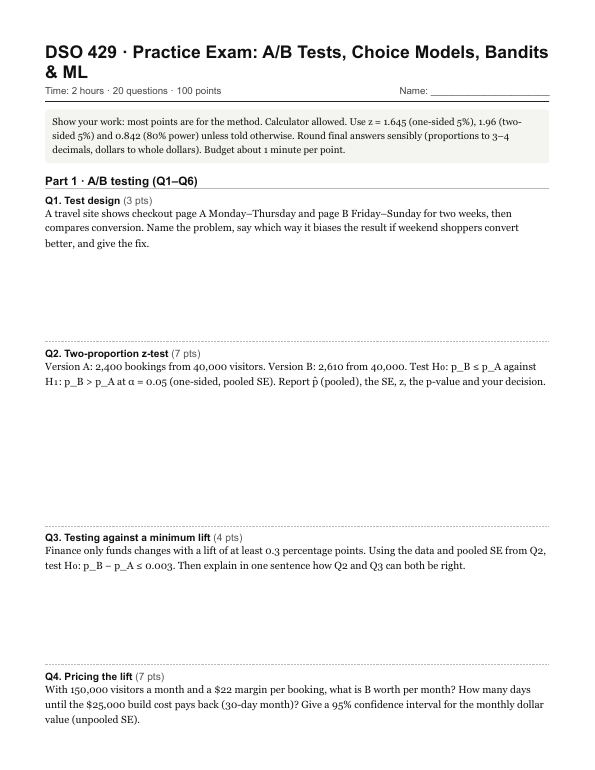
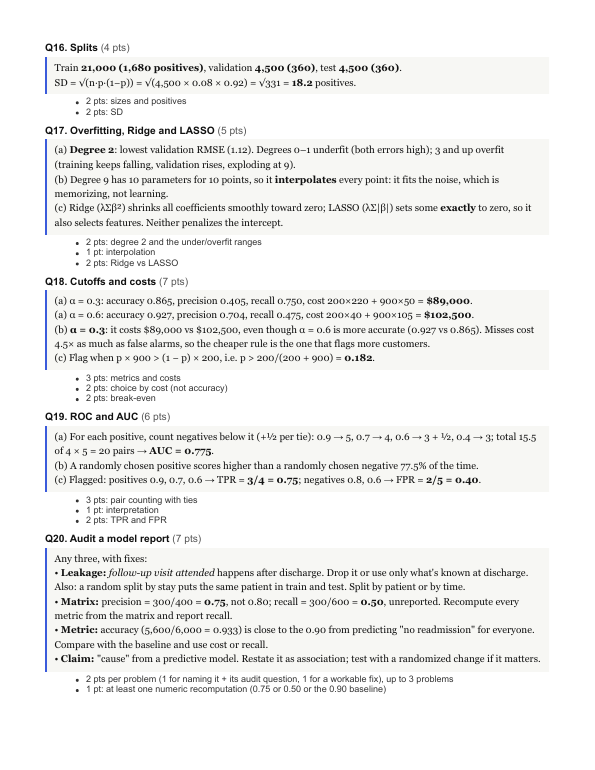

# HW4 Practice Exam 📝

A **2-hour, 20-question, 100-point** practice exam on everything in DSO 429 HW4, with a separate **fully worked answer key** and a **grading rubric**. Both are printable PDFs.

- [`exam.pdf`](exam.pdf): 6 pages, with answer space under every question.
- [`answer_key.pdf`](answer_key.pdf): 5 pages. Every step is worked, each question has a point-by-point rubric, and there's a score grid with grade bands.

| Exam | Answer key |
|---|---|
|  |  |

## Coverage

| Part | Questions |
|---|---|
| A/B testing | Q1 confounded design · Q2 pooled z-test · Q3 test against a minimum lift · Q4 lift → dollars, payback, dollar CI · Q5 sample size and the 1/d² rule · Q6 peeking |
| Choice models | Q7 logit shares and Gumbel errors · Q8 coefficient significance and WTP · Q9 IIA and the identical clone · Q10 McFadden ρ² |
| Bandits | Q11 regret of test-then-ship · Q12 ε-greedy's floor · Q13 ε-greedy probabilities · Q14 Thompson posteriors and updates |
| Machine learning | Q15 model families · Q16 stratified splits and SD · Q17 validation curve, Ridge vs LASSO · Q18 confusion matrices, costs, break-even cutoff · Q19 ROC point and AUC by pair counting · Q20 audit a model report |

It mixes calculations with short answers. All numbers are **new** (not HW4's), so it's a real test of method rather than memory.

## How it's made

`make_exam.py` writes both documents and **computes every number in the key**, so the key can't contain arithmetic slips. The answer text for choices, such as which cutoff is cheaper, is generated from the computed values. That caught a design error in Q18 during development: the first cost numbers made the "obvious" answer wrong.

```
python3 make_exam.py     # exam.html/.pdf, answer_key.html/.pdf, answers.json (Chrome renders the PDFs)
python3 test_exam.py     # 22 checks
```

## Tests (`test_exam.py`)

- **Structure:** 20 questions, 100 points, every question in both documents, and no answers leaking into the exam.
- **Rubric:** every question's rubric points add up to its value.
- **Independent recomputation of the key** (using `statistics.NormalDist` and direct formulas):
  - z-tests, the minimum-lift test, the unpooled dollar CI and payback
  - sample size 31,106 per arm and 13 days
  - logit shares, WTP, IIA shares, ρ²
  - regret, the ε floor, the Thompson update
  - the split SD, cutoff costs (cheapest ≠ most accurate), AUC = 0.775, and the audit recomputations
- **Rendering:** the key quotes the computed numbers, and the PDFs exist with sensible page counts.
